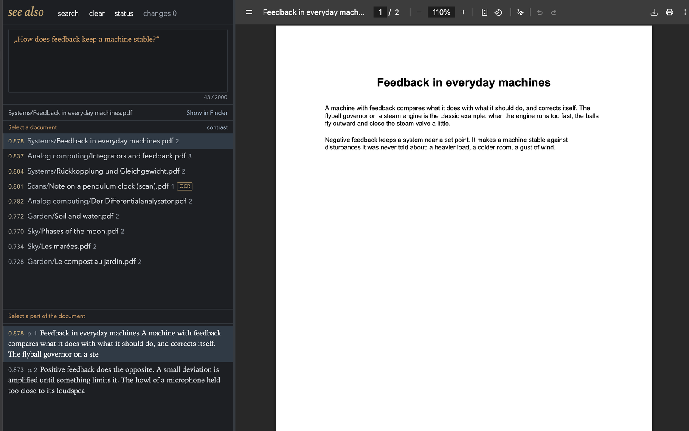
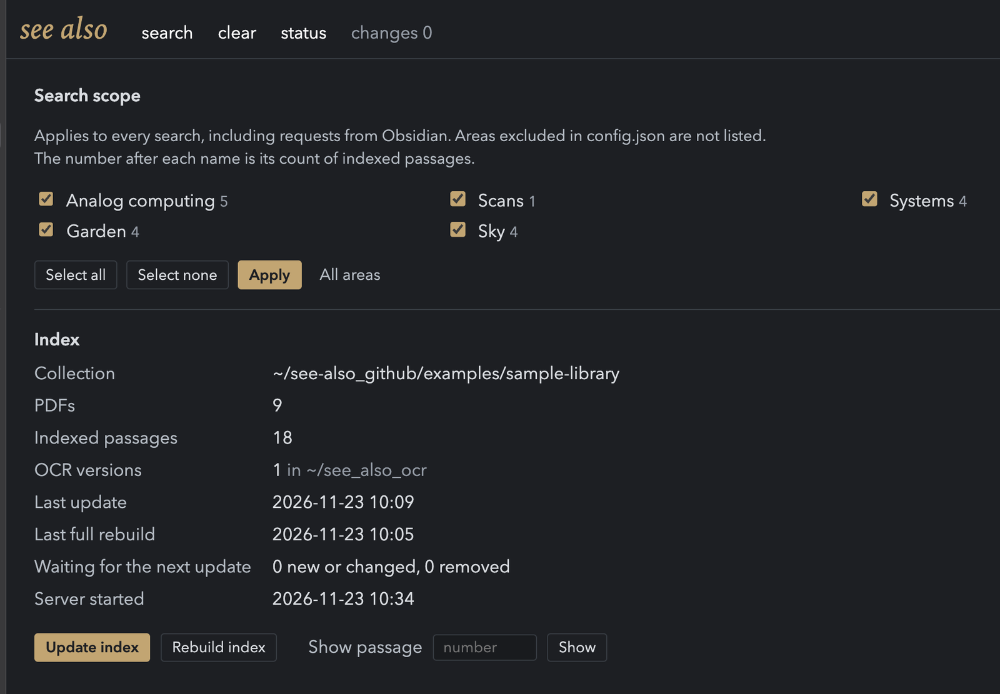
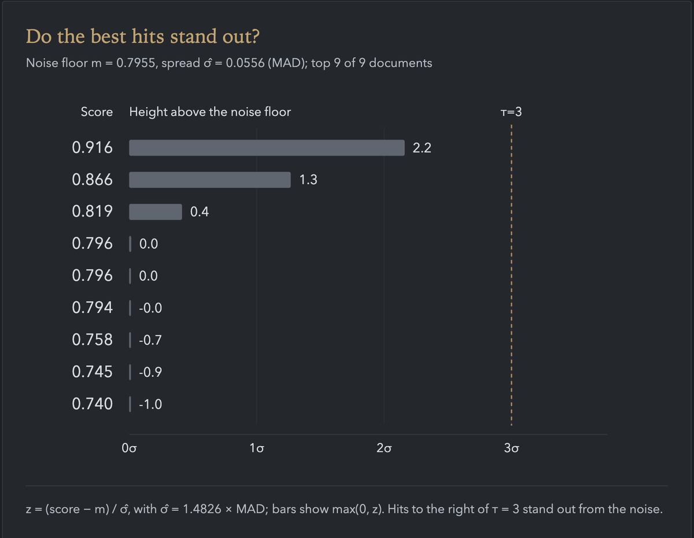

# see_also

**Local semantic search over your own PDF collection – in the browser, without the cloud.**

see_also answers one question: *what do my PDFs say about topic X?* You describe the topic with a
phrase, a sentence or a few keywords, and see_also returns the passages in your PDFs that come
closest in meaning, with document, page and the text itself. It returns **places, not answers**:
nothing is generated, and every hit opens at the right page.



*A search in the sample library from `examples/`. The query is English; the German documents on
the same topic follow right behind, because the model is multilingual. The scan is found through its
OCR version.*

- Runs entirely on your own computer. After a one-time model download it needs no network.
- Finds passages by meaning, across English, German, French and many other languages.
- Scales to large collections: in daily use on about 17,000 PDFs and 830,000 passages; a search
  takes about 0.2 s.
- Makes scanned PDFs searchable with OCR, without touching the originals.
- Can be called from Obsidian: select text in a note, click, see what your PDFs say about it.

Status: a personal tool, in daily use on one Mac since mid-2026, now published as is. Tested on
macOS; see *Platforms* for Linux and Windows.

---

## Contents

- [What it does and does not do](#what-it-does-and-does-not-do)
- [Platforms and requirements](#platforms-and-requirements)
- [Installation](#installation)
- [First run with the sample library](#first-run-with-the-sample-library)
- [Using your own collection](#using-your-own-collection)
- [Usage](#usage)
- [Configuration](#configuration)
- [Offline use](#offline-use)
- [Tests](#tests)
- [Measured scale](#measured-scale)
- [Limitations and open issues](#limitations-and-open-issues)
- [Third-party software and licences](#third-party-software-and-licences)
- [License](#license)
- [Disclaimer](#disclaimer)

---

## What it does and does not do

**How it works**

1. **Indexing.** Every PDF below a root folder is read page by page and cut into passages
   ("chunks") of about 1,500 characters with 200 characters of overlap. A chunk never crosses a
   page boundary, so every hit has a page number. PDFs inside application bundles (`.app`, `.pkg`,
   plug-ins) are skipped.
2. **Embedding.** The model [`intfloat/multilingual-e5-large`](https://huggingface.co/intfloat/multilingual-e5-large)
   turns each chunk into a 1024-dimensional vector that represents its meaning. Vectors and texts
   are stored in one SQLite file, `see_also.db`.
3. **Search.** The query is embedded the same way and compared with *all* stored vectors (cosine
   similarity, exact, no approximate index). Per document the best passage counts.
4. **Contrast.** A similarity search always returns *something*. The **contrast** view estimates a
   noise floor from all scores of a search and shows whether any hits really stand out from it –
   the answer to the question *is the best hit relevant, or just the least irrelevant?*

**What it does not do**

- No generated answers, summaries or chat.
- PDFs only. Scans without a text layer become searchable only after OCR.
- No keyword search: a passage can match without containing the query word, and an exact term can
  be missed if its context differs. Formulas and diagrams are largely opaque.
- The model reads at most 512 tokens (roughly 350 words) of a query; longer queries are cut.

---

## Platforms and requirements

| Platform | Status |
|---|---|
| **macOS, Apple Silicon** | Tested and in daily use (macOS Tahoe, Python 3.14). The model runs on the GPU (MPS). |
| **macOS, Intel** | Not tested. Should work; the model runs on the CPU (slow indexing). |
| **Linux** | Not tested in daily use; the test suite passes on Linux. Probably works, with the model on the CPU. "Show in Finder" does not work, and the "Copy command" on the review page assumes a Trash folder that you set with `trash`. |
| **Windows** | Does not run as is: the run lock uses `fcntl`, and some helpers call macOS programs. **WSL2** (Linux on Windows) is the probable route; not tested. |

The model runs on Apple's GPU (MPS) if available, otherwise on the CPU. NVIDIA GPUs (CUDA) are not
used at present.

**Requirements**

- Python 3.11 or newer (developed with 3.14).
- Disk: about 2.2 GB for the model, plus about 7.5 KB per passage for the index
  (830,000 passages ≈ 6 GB).
- Memory (measured on the reference machine, see *Measured scale*): the server needs about 4 KB per
  passage for the vectors plus about 3.5 GB for the model; an indexing run peaks at 5 to 10 GB.

**Estimated minimum by collection size** (estimates from the measurements above, not tested on
smaller machines):

| Collection | Passages (approx.) | RAM | Indexing on Apple GPU | Indexing on CPU |
|---|---|---|---|---|
| A few hundred PDFs | 20,000 | 8 GB | about 30 min | several hours |
| A few thousand PDFs | 200,000 | 16 GB | about 5 h | days |
| 15,000+ PDFs | 800,000 | 32 GB | about 20 h | not advisable |

The indexing time is spent once; afterwards only new and changed files are processed. The CPU
column is a rough guess: the model has 560 million parameters, and without a GPU each passage takes
several times longer.

**Optional, for OCR:** [`ocrmypdf`](https://ocrmypdf.readthedocs.io/) and
[Tesseract](https://github.com/tesseract-ocr/tesseract) with the language packs you need, optionally
Ghostscript. On macOS: `brew install ocrmypdf tesseract-lang ghostscript`.

---

## Installation

```bash
git clone https://github.com/YukanQ/see-also.git
cd see-also
python3 -m venv venv
venv/bin/python3 -m pip install -r requirements.txt
cp config.example.json config.json
```

Check that everything is there (on a Mac with Apple Silicon, `MPS: True`):

```bash
venv/bin/python3 -c "import pymupdf, flask, sentence_transformers, torch; print('ok, MPS:', torch.backends.mps.is_available())"
```

A venv stores its own absolute path. Do not move or rename the project folder afterwards; if you
do, delete `venv/` and create it again.

---

## First run with the sample library

`config.example.json` points to the sample library in `examples/sample-library`: nine short PDFs in
English, German and French, in five folders, one of them a scan without a text layer. It is the
quickest way to see see_also work.

```bash
venv/bin/python3 app.py
```

1. Open <http://localhost:5001>. Keep the terminal open; Ctrl+C stops the server.
2. The first start downloads the model (about 2.2 GB, a few minutes). The terminal shows
   `Model loaded` when it is ready.
3. Click **status**, then **Rebuild index**. With the sample library this takes well under a
   minute.
4. Click **search**, type a question – for example *How does feedback keep a machine stable?* – and
   press Cmd+Enter (Ctrl+Enter) or **search**.
5. Click a document, then a passage: the PDF opens on the right at that page.



**Try OCR** (needs `ocrmypdf`): the status page lists one PDF without text, the scan in `Scans/`.
Click **Run OCR**, then **Update index**; the scan becomes searchable and is marked **OCR** in the
results.

---

## Using your own collection

Set `pdf_base_dir` in `config.json` to the root folder of your PDFs, for example
`"~/Documents/Library"`. Every first-level subfolder becomes an **area**; areas can be included in
or left out of each search (the **search scope** on the status page).

Restart the server and click **Rebuild index** (or **Update index**; on an empty index both do the
same). For a large collection it is better to start with a few areas: put the others into
`excluded_areas`, index, then remove them from the list one at a time and click **Update index**.
Each run writes a log to `logs/`.

On a Mac the computer is kept awake during a run (`caffeinate`), so a large first run can go on
overnight on mains power.

Tip for macOS: exclude the OCR folder and the project's `logs` and `backups` from Spotlight
(System Settings → Spotlight).

---

## Usage

### Search page

- **search** (or Cmd+Enter, Ctrl+Enter) runs the query; **clear** resets everything. Esc closes
  the contrast view.
- The document list shows score, folder, file name and the number of matching passages. Documents
  indexed from an OCR version are marked **OCR**.
- Select a document: its best passages appear below, with page number. Select a passage: the PDF
  opens on the right at that page.
- **Show in Finder** reveals the file (macOS). **OCR version** opens the OCR version of a scanned
  document, with selectable text.
- **contrast** shows which hits stand out from the noise floor. If all scores lie close together
  and the documents have nothing to do with each other, the search has most likely found nothing.



*The contrast view for a search in the sample library. With only nine documents nothing clears the
threshold τ = 3; in a large collection, hits that are really about the topic stand clearly above the
mass of loosely related passages.*

### Status page

- **Search scope:** tick the areas to search in, then **Apply**. Applies to every search, including
  requests from Obsidian, until changed.
- **Index:** figures and the files waiting for the next update.
  - **Update index** processes new and changed files and removes passages of deleted ones. This is
    the normal way to keep the index current.
  - **Rebuild index** starts from scratch. It is rarely needed, because an index updated step by
    step is as good as a rebuilt one.
  - Both show progress and remaining time and can be cancelled; a cancelled run leaves the index
    unchanged.
- **PDFs without text:** files from which the index got no text, mostly scans. From here:
  - **Run OCR** (see below),
  - **Files to review:** damaged, empty, encrypted or unreadable files, grouped, each with **Show in
    Finder** and **Open**. **Copy command** puts a quoted terminal command into the clipboard that
    moves all files of a group to the Trash; see_also itself never deletes anything.
  - **OCR found no text:** scans of photos, drawings, sheet music and the like, by area.
- **Show passage** shows one passage by its number.

### OCR for scanned PDFs

**Run OCR** asks how many files to process and then works on its own, smallest files first,
several at a time. It runs `ocrmypdf` (by default English, German, French) and stores each result
in a separate folder (`ocr_folder`, by default `~/see_also_ocr`) under the same relative path.
**The originals are never changed.**

- Known refusals of ocrmypdf get a second attempt automatically.
- Files that cannot be processed are sorted out with a reason (empty, encrypted, not a PDF,
  truncated …) and appear under **Files to review**.
- **Stop OCR** stops at once; the next run continues where it stopped.
- OCR and indexing never run at the same time.

OCR does not make files searchable by itself: the next **Update index** reads the text from the OCR
version and stores it under the original's path. Hits always point to the original.

### Obsidian

The plugin in `obsidian/send-to-see-also` sends the selected text (or the whole note) to see_also,
which runs it as a search and shows the result in the browser.

1. Copy `main.js` and `manifest.json` into `<vault>/.obsidian/plugins/send-to-see-also/`.
2. Enable **Send to see_also** under Settings → Community plugins.

It adds a ribbon button, a command and an entry in the editor's context menu. Without Obsidian, any
program can do the same:

```bash
curl -s -X POST http://127.0.0.1:5001/briefkasten -H 'Content-Type: application/json' -d '{"text":"feedback and stability"}'
```

### Maintenance tools

Run in the project folder; all are safe while the server is running.

| Command | Purpose |
|---|---|
| `venv/bin/python3 tools/backup_index.py` | Consistent, verified copy of `see_also.db` to `backups/<time>/`. |
| `venv/bin/python3 tools/check_index.py` | Read-only consistency check of the index. |
| `venv/bin/python3 tools/messwerte.py` | Passages per area, figures of the last run. |
| `venv/bin/python3 tools/pdf_pruefen.py <area>` | Test-read one area before adding it. |
| `venv/bin/python3 tools/pdf_dateiende.py` | Find truncated PDFs (no end-of-file marker). |

---

## Configuration

`config.json` (copy of `config.example.json`). Read at server start.

| Key | Meaning | Default |
|---|---|---|
| `pdf_base_dir` | Root folder of the collection; absolute, with `~`, or relative to the project folder. | `examples/sample-library` |
| `excluded_areas` | First-level folders to leave out entirely. | `[]` |
| `search_max_results` | Documents shown per search. | `10` |
| `chunk_list_max_entries` | Passages shown per document. | `6` |
| `phrase_max_chars` | Maximum query length. | `2000` |
| `cross_page_overlap_chars` | Characters taken from the neighbouring page for embedding (display stays within the page). | `200` |
| `embed_batch_size` | Passages per embedding batch. | `32` |
| `gpu_cache_clear_every_batches` | Empty the GPU cache every N batches (keeps peak memory down; 0 = never). | `50` |
| `max_files_per_incremental_run` | Limit for one update; `null` = no limit. | `null` |
| `pdf_read_isolated` | Read each PDF in a separate worker process, so a crashing or hanging PDF cannot stop the run. | `true` |
| `pdf_time_limit_s` | Time limit for reading one PDF. | `300` |
| `index_run_own_process` | Run indexing in its own process (returns its memory afterwards). | `true` |
| `index_run_nice` | Priority of the indexing process (0 normal, 19 lowest). | `10` |
| `embed_pause_ms` | Pause after each batch, to keep the computer responsive. | `0` |
| `ocr_folder` | Folder for OCR versions. | `~/see_also_ocr` |
| `ocr_languages` | Tesseract languages, in order of priority. | `eng+deu+fra` |
| `ocr_time_limit_per_page_s` / `ocr_time_limit_min_s` | Time limit for OCR of one file: per page, at least the minimum. | `60` / `300` |
| `ocr_parallel` | Files processed at the same time. | `4` |
| `ocr_jobs` | Cores per file; `null` = all cores divided by `ocr_parallel`. | `null` |
| `trash` | Target folder of **Copy command** on the review page. On Linux e.g. `~/.local/share/Trash/files/`. | `~/.Trash/` |
| `scan_cache_s` | How long one scan of the folder tree is reused by the pages. | `60` |
| `load_model_at_start` | Load the model right after start, so the first search is fast. | `true` |
| `model_offline` | `"auto"`: load the model offline once it is downloaded; `true`/`false` force it. | `"auto"` |
| `debug` | Flask debug mode (development only; also `SEE_ALSO_DEBUG=1`). | `false` |
| `storage` | Only `"sqlite"`. | `"sqlite"` |

The server listens on `127.0.0.1:5001` only, so it cannot be reached from other computers. At
start Flask warns that this is a development server; that warning is meant for servers open to many
users and does not apply here.

---

## Offline use

The model is not part of the repository. On first use, `sentence-transformers` downloads it from
the Hugging Face Hub into the usual cache (`~/.cache/huggingface/hub/`; change it with `HF_HOME`).
From then on see_also loads it offline (`model_offline: "auto"`) and makes no network requests at
all. Searching, indexing, OCR and the Obsidian plugin work without a network.

Do not change the model on an existing index: the stored vectors only fit the model that made
them. Another model means a full rebuild.

---

## Tests

```bash
venv/bin/python3 -m pip install pytest
venv/bin/python3 -m pytest
```

16 test cases, about one to two minutes, without the model, without PyTorch and with all network
access blocked. Details in [tests/README.md](tests/README.md). GitHub runs the suite on Linux and
macOS on every push.

---

## Measured scale

Reference installation: MacBook Pro, Apple Silicon, 32 GB RAM, macOS Tahoe, November 2026.

| | |
|---|---|
| Collection | 16,886 PDFs in 15 areas; 16,731 with text (2,941 of them via OCR) |
| Index | 831,210 passages, `see_also.db` 6.1 GB |
| Server start | index loaded in 3 s (3.5 GB memory), model in 11 s (offline) |
| Search | about 0.2 s |
| Indexing | about 10.7 passages per second on the GPU |
| Peak memory of an indexing run | 5 to 10 GB |
| OCR | 0.7 to 0.8 s per page for multi-page files, 4 files in parallel |

---

## Limitations and open issues

- **OCR quality.** OCR text of poor scans contains errors; the semantic search tolerates some.
- **Garbled text layers.** PDFs with a badly encoded text layer are indexed as gibberish and are
  not detected.
- **Duplicates.** The same document in several folders is indexed several times and can fill the
  result list.
- **Change detection** uses the modification time only.
- **Windows** needs porting (or WSL2); **CUDA** is not used.
- Code comments, internal names and the test check texts are still partly German.

---

## Third-party software and licences

see_also itself is under the MIT License. It uses, but does not include, the following software and
model. Their licences apply to them; please check them yourself if you redistribute see_also
together with them.

| Component | Purpose | Licence (as far as known) |
|---|---|---|
| [PyMuPDF](https://pymupdf.readthedocs.io/) | Reading PDFs | AGPL-3.0 or commercial licence |
| [Flask](https://flask.palletsprojects.com/) | Web server | BSD-3-Clause |
| [sentence-transformers](https://www.sbert.net/), [PyTorch](https://pytorch.org/) | Running the model | Apache-2.0, BSD-style |
| [NumPy](https://numpy.org/) | Vectors | BSD-3-Clause |
| [intfloat/multilingual-e5-large](https://huggingface.co/intfloat/multilingual-e5-large) | Embedding model | MIT |
| [ocrmypdf](https://ocrmypdf.readthedocs.io/) (optional) | OCR, called as a program | MPL-2.0 |
| [Tesseract](https://github.com/tesseract-ocr/tesseract) (optional) | OCR engine | Apache-2.0 |
| [Ghostscript](https://www.ghostscript.com/) (optional) | PDF rasteriser for difficult files | AGPL-3.0 or commercial licence |

The texts of the sample library were written for this project and are covered by the MIT License
of the repository.

---

## License

MIT – see [LICENSE](LICENSE).

---

## Disclaimer

see_also was developed with Claude (claude.ai), an AI assistant by Anthropic. The code has not been
reviewed line by line by a human. AI can make mistakes. Use see_also at your own risk; as the
license says, it comes without any warranty.
